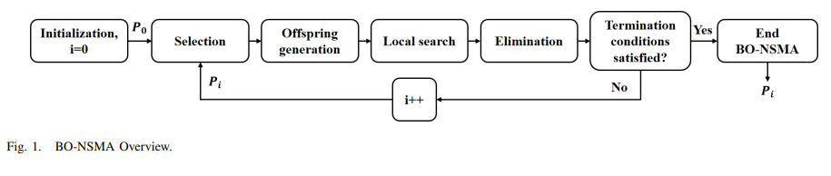
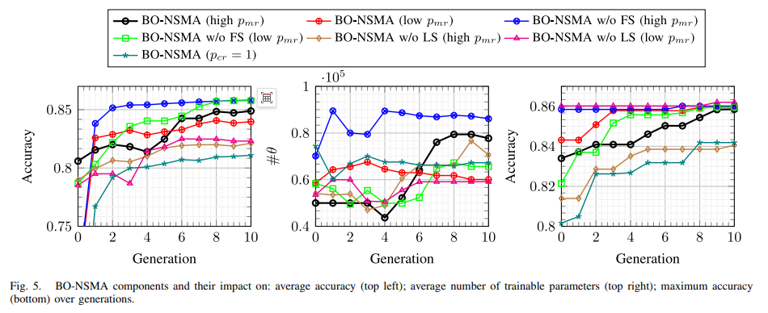
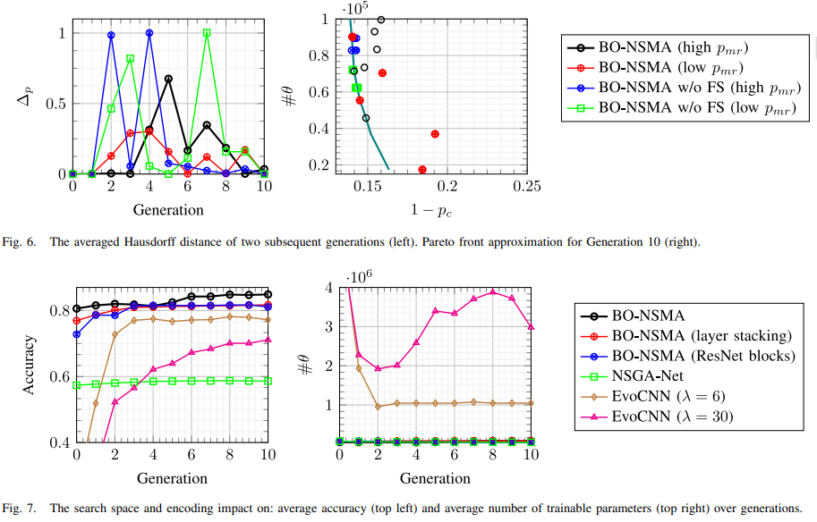

# [Modulation Identification] Evolution and Optimization of Residual Neural Network Architecture in Modulation Classification Application with Python Code

In current and future wireless communication systems, automatic modulation classification has received widespread attention. Deep learning, as a powerful tool, is applied to modulation classification, capable of jointly learning discriminative features and performing signal classification. However, optimizing the deep neural network architecture for modulation classification is a manual and time-consuming process that requires substantial domain knowledge and effort. Most state-of-the-art solutions primarily focus on improving classification accuracy while neglecting the optimization of network complexity. This paper proposes a novel dual objective gene algorithm (BO-NSMA) for searching for the optimal deep neural network architecture for modulation classification, aiming to maximize classification accuracy while minimizing network complexity. Experiments show that BO-NSMA, with an initial population of only six individuals and requiring only ten generations, can find deep neural network architectures that outperform all manually designed architectures in performance. Additionally, BO-NSMA discovered the first low-complexity convolutional neural network architecture, which performs slightly better than high-cost recurrent neural network architectures, reducing network complexity by 2.9 times and enhancing performance by 1.43%. Compared to similar methods in network architecture search, BO-NSMA achieves up to 18.73% higher accuracy and up to 82 times lower network complexity. The results are verified through Wilcoxon signed rank test.
Introduction: Automatic Modulation Classification (AMC) serves as an intermediate step between signal detection and demodulation, playing a crucial role in the design of future wireless communication intelligent transceivers. It plays a key role in dynamic spectrum access (DSA) and resource allocation. Moreover, it is a critical enabling technology for many other spectrum sensing applications such as signal monitoring, intrusion detection, interference identification, and numerous regulatory and defense applications.
The study of automatic modulation classification has been ongoing for over 40 years, with three main methods: likelihood-based (LB), feature-based (FB), and deep learning (DL). The LB method formulates AMC as a multi-hypothesis problem, assuming the number of hypotheses equals the number of target modulation schemes. Despite being optimal in the Bayesian sense, the LB method requires prior knowledge of all signal and channel parameters, which is computationally expensive. On the other hand, the FB method classifies by using pre-designed discriminative features, which reduces the computational cost compared to the LB method. However, its performance heavily relies on the discriminativeness and noise resistance of the extracted features, and designing suitable features is challenging. Unlike the FB method, DL can automatically learn radio characteristics from raw I/Q data, outperforming the FB method in performance.
Due to the ability of deep learning to jointly learn discriminative features from raw I/Q data and classify signals based on these features, it has been widely used in AMC. The methods based on deep learning are mainly divided into two categories: Recurrent Neural Networks (RNN) and Convolutional Neural Networks (CNN). Since RNNs have higher computational costs and memory requirements, CNNs are more favored for classification tasks. However, deeper CNN architectures suffer from gradient vanishing problems, making them unsuitable for complex classification tasks as network performance decreases with depth. In recent years, inspired by RNNs, new models such as Residual Neural Networks (ResNet) and Aggregated Residual Transformation Networks (ResNeXt) have been proposed, which outperform state-of-the-art CNN models such as the AMC model based on ResNet and the AMC model based on ResNeXt. ResNet and ResNeXt are modular architectures composed of pre-designed blocks stacked together, with various designs for ResNet blocks and ResNeXt blocks already available. Although deep neural networks (DNN) have achieved great success in AMC, designing an efficient and accurate DNN architecture is usually a manual and time-consuming process that requires deep domain knowledge. Moreover, many AMC applications require real-time operation and fast inference, and the lower the complexity of the DNN architecture, the faster the inference speed. The following challenges make this process even more difficult:
The vast search space: Even with a simple CNN architecture, the search space is large, encompassing factors such as the number of layers, the number of filters per layer, and the size of the filters. For example, a simple ResNet-18 network has 18 layers (including 16 convolutional layers and 2 pooling layers), and when it comes to architectural optimization, there could be 8, 16, 32, 64, or 128 filters in 16 layers, with filter sizes of 1 or 3. This generates a massive search space, and random search may take days or weeks. In recent years, computer vision has widely adopted two heuristic methods based on reinforcement learning (RL) and genetic algorithms (GA) for network architecture search (NAS). The former uses RL to guide the search, while the latter is a population-based metaheuristic algorithm that reflects natural selection. The RL-based method is computationally expensive and is not suitable for multi-objective optimization problems (MOOP). In contrast, genetic algorithms are highly efficient in handling multi-objective optimization problems because their population-based nature allows for a set of solutions to be obtained in a single run. However, NAS is rarely considered in deep learning-based AMC.
Data-centric solutions: Most existing artificially designed AMC DNN architectures are optimized for a single modulation set. Adding new modulation formats and / or changing input features can likely degrade DNN performance, triggering re-optimization of the architecture. To enable this re-optimization, genetic algorithms need a flexible search space and encoding scheme to be robust to input feature changes. Most genetic algorithms used for NAS ignore this point, requiring new search spaces and encoding schemes when input feature spaces change. Research has proposed pre-designed blocks that fail when input feature changes, and studies have suggested that shallow CNN architectures perform poorly in complex feature spaces.
Maximizing classification accuracy while ignoring network complexity: All artificially designed AMC DNN architectures focus on maximizing classification accuracy, while reducing network complexity is overlooked. However, these human-designed DNN architectures may not be optimal in terms of connectivity and hyperparameter values. As mentioned earlier, genetic algorithms provide some techniques for solving multi-objective optimization problems, but the genetic algorithm applied to NAS for AMC remains single-objective driven.
In addition to RL and GA, there are other methods for optimizing DNN architectures. Some studies pre-select an artificially designed DNN and then apply pruning based on greedy criteria to reduce the number of trainable parameters per layer, which primarily depends on the initial architecture chosen by humans. Other studies consider knowledge distillation for NAS, transferring knowledge from a trained teacher network to a smaller, faster student model to compress the DNN architecture. This method has significantly lower computational costs than GA, but it may not find the optimal solution as it does not explore the entire search space. Knowledge distillation can be combined with RL to accelerate the convergence speed of NAS based on RL. For AMC applications, having a DNN architecture with high classification accuracy while maintaining low complexity is very important. The time spent searching for such an architecture is not critical, so a GA method that can find near-globally optimal architectures can be applied.
This paper proposes a novel AMC algorithm called BO-NSMA (Bi-Objective Network Search Meme Algorithm), which aims to simultaneously optimize classification accuracy and network complexity. The meme algorithm is an extension of the genetic algorithm with local search (LS). The main goal of the LS operator is to steer candidate solutions towards more promising regions in the search space, where it is likely to find the optimal solution. Therefore, a carefully designed LS operator can accelerate the convergence speed of the GA, as demonstrated in this paper. The optimization of network complexity takes into account the connectivity and hyperparameters of variable length network architectures. The main contributions of this paper are summarized as follows:
The first study investigates the application of NAS based on multi-objective GA in AMC. This paper identifies the key components of the proposed BO-NSMA, such as fitness sharing (FS), local search (LS), and adaptive mutation and crossover rates, which enable it to find a diverse population close to the Pareto front. It is important to note that the Pareto front is a set of non-dominated individuals, known as Pareto optimal solutions, which can be infinite in number. The impact of the search space and encoding on the convergence speed of GA and AMC performance was deeply explored.
It has been demonstrated that BO-NSMA can find a very diverse population close to the Pareto front for a small set of six individuals. Furthermore, it shows that BO-NSMA outperforms all artificially designed DNN-based AMCs by up to about 2% in accuracy and by reducing network complexity by up to about 5 times.
A new termination criterion is proposed to effectively balance the trade-off between search duration and performance obtained.
Figures are included in the article.
Conclusion Despite the significant achievements of deep neural networks in automatic modulation classification (AMC), manually optimizing their architecture is challenging due to the vast search space. Moreover, given optimization architectures often fail to transfer well when input features change, leading to repetitive and cumbersome optimization efforts. In the field of computer vision, genetic algorithms (GA) for automated network architecture search (NAS) have gained widespread attention. However, as shown by NSGA-Net, transferring these methods smoothly to time series problems such as modulation recognition results in suboptimal performance. Therefore, this paper proposes BO-NSMA, a novel dual-objective gene algorithm for jointly optimizing architecture and network complexity in deep neural network-based modulation recognition applications. By incorporating local search (LS) into the genetic algorithm to accelerate convergence and improve performance. Extensive experiments demonstrate that BO-NSMA can find diverse populations that are very close to the Pareto frontier defined by performance and complexity. The architectures found by BO-NSMA outperform all hand-designed deep neural networks. Additionally, it is shown that BO-NSMA does not suffer from premature convergence issues with smaller population sizes, while its counterpart algorithm EvoCNN does. The significance of the obtained results is confirmed through Wilcoxon signed-rank tests.

## Images

<!-- PAYMENT_BLOCK -->

## Get this dataset

- Payment link (Stripe): [Buy now](https://buy.stripe.com/3cs8yP7sY87d0vu9AB)
- Payment QR code: 

<!-- /PAYMENT_BLOCK -->
